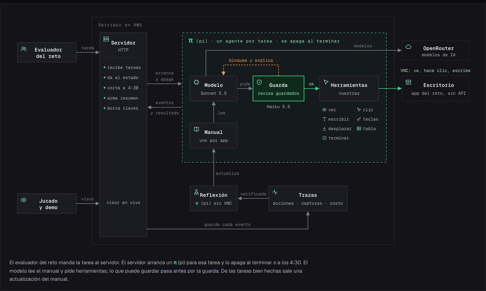

# Operador · una API sobre la pantalla

Agente del **Reto 1 de Frontier**: recibe una tarea en lenguaje natural y la ejecuta en una aplicación
de escritorio que no tiene API, viendo solo la pantalla por VNC, como lo haría una persona.

- Diseño del sistema: [frontier.cuisangelo.com/system-design](https://frontier.cuisangelo.com/system-design) · [`docs/diseno.md`](docs/diseno.md)
- Respuesta al incidente del cambio de tema: [`docs/incidente-FR-0153.md`](docs/incidente-FR-0153.md)
- Bitácora del día, con los errores y cómo se corrigieron: [`docs/bitacora.md`](docs/bitacora.md)

## Resultados

| Corrida del set oculto (56 tareas, app nunca vista) | Puntaje |
| --- | --- |
| 1 · casi todo con la primera versión | 33 / 56 |
| 2 · versión actual | **51 / 56** (fáciles 17/17, regulares 22/23, difíciles 12/16) · mediana 1 min 3 s |

- **Banco propio en la app de práctica:** 14 de 14 antes y 14 de 14 después del cambio de tema, sin tocar el código.
- **Por tarea:** unos $0.10 y 73 s.
- **Latencia:** `POST /tasks` responde en menos de 30 ms.

## Cómo funciona



1. **Servidor HTTP** (`src/server.ts`): implementa el contrato y lanza **un proceso de `pi` por tarea**.
   - Lo corta antes de los 5 minutos.
   - Guarda cada tarea en disco.
   - Sirve el panel.
2. **`pi` es el cerebro** (`src/agent/run-task.ts`): un harness de agentes que corre con Sonnet 5.5 en OpenRouter.
3. **Herramientas sobre la pantalla** (`src/agent/extension.ts`): ver, clic, escribir, llenar formulario, elegir en lista, teclas, desplazar y terminar.
   - Cada acción espera a que la pantalla se quede quieta y devuelve una captura nueva.
   - No hay coordenadas ni selectores fijos: el modelo decide cada clic sobre la captura del momento.
4. **Guarda** (Haiku 5.5): revisa toda acción que guarda datos y la bloquea si la pantalla contradice la tarea.
5. **Manual por app** (`src/agent/manual.ts`): al cerrar cada tarea, otro `pi` sin pantalla resume lo aprendido en `memoria/<app>.md`.
   - Guarda solo rutas y nombres, nunca coordenadas ni datos.
   - La tarea siguiente lo recibe como pistas.
6. **Cliente VNC propio** (`src/vnc/`): RFB 3.8 sobre WebSocket, con autenticación VNC y codificación PNG, sin dependencias.
7. **Trazas y panel** (`src/panel/index.html`): cada paso queda con captura, acción, veredicto de la guarda, razonamiento del modelo, costo y motivo de cierre.

El procedimiento que sigue el agente está en [`src/agent/system-prompt.md`](src/agent/system-prompt.md).

## Contrato

Todas las llamadas llevan `Authorization: Bearer <TEAM_TOKEN>`.

| Endpoint | Qué hace |
| --- | --- |
| `GET /health` | `200` cuando el servicio está listo |
| `POST /tasks` | Recibe `{"tarea": "…", "escritorio": {"url": "wss://…/websockify", "password": "…"}}` y responde `{"task_id": "…"}` enseguida |
| `GET /tasks/{task_id}` | `{"estado": "en_curso" \| "terminada" \| "fallida", "resumen": "…"}` |
| `GET /panel` | Panel de tareas: pide `VIEWER_TOKEN` |

## Correrlo en local

**Requisitos:**
- Node 24 o más nuevo. Corre TypeScript directo, sin compilar.
- `pnpm`.
- `pi`:
  ```sh
  pnpm add -g @earendil-works/pi-coding-agent@1.1.0
  ```

```sh
cp .env.example .env        # completa OPENROUTER_API_KEY, TEAM_TOKEN y VIEWER_TOKEN
env PORT=8080 DATA_DIR=./data PI_BIN="$(command -v pi)" \
  AGENT_MODEL=anthropic/claude-sonnet-5.5 GUARD_MODEL=anthropic/claude-haiku-5.5 AGENT_THINKING=high \
  node --env-file=.env --openssl-legacy-provider src/server.ts
```

`--openssl-legacy-provider` hace falta porque la autenticación VNC usa DES.

**Mandar una tarea:**

```sh
curl -s localhost:8080/tasks -H "Authorization: Bearer $TEAM_TOKEN" -H 'Content-Type: application/json' \
  -d '{"tarea":"Registra al cliente Papelería Los Andes, NIT 901234567, teléfono 3157654321, ciudad Pereira.",
       "escritorio":{"url":"wss://<escritorio>/websockify","password":"<contraseña>"}}'
curl -s localhost:8080/tasks/<task_id> -H "Authorization: Bearer $TEAM_TOKEN"
```

Panel: `http://localhost:8080/panel?token=<VIEWER_TOKEN>`.

## Desplegar

Corre en AWS EC2 con Docker Compose: el agente, un panel de solo lectura y Caddy con HTTPS automático.

```sh
# en el servidor, con el repo en /opt/agent y el .env completo
AGENT_VERSION=$(git rev-parse --short HEAD) docker compose up -d --build
```

- `deploy/user-data.sh` prepara una instancia nueva: Docker y el plugin de compose.
- `deploy/swap-on-server.sh <versión>` cambia el agente **entre dos tareas**, sin cortar una en curso.
- `deploy/pull-data.sh <dir>` baja las tareas y trazas del servidor. Pueden traer texto del set oculto: no las subas al repo, `data/` está ignorado.

## Probar y medir

El material del reto está en `material/`:
- `material/pruebas/`: 5 tareas de ejemplo.
- `material/retos/`: 9 retos propios con trampas (claves, homónimos, borrados masivos, registros que no existen).

Cada tarea se corre contra el escritorio de pruebas: reinicia el escritorio, ejecuta el agente y juzga con `/__check`.

| Comando | Qué hace | ¿Gasta crédito? |
| --- | --- | --- |
| `node --openssl-legacy-provider scripts/vnc-smoke.ts .env out.png` | Conecta por VNC y guarda una captura | No |
| `node --openssl-legacy-provider scripts/explore.ts .env out click:x,y …` | Explora la app a mano, sin modelo | No |
| `THINKING=high MANUAL=1 node --openssl-legacy-provider scripts/run-test.ts .env material/pruebas/E1-crear-cliente.json` | Una tarea de punta a punta, con juicio | Sí, ~$0.08 |
| `scripts/run-suite.sh .env anthropic/claude-sonnet-5.5 material/pruebas/*.json material/retos/*.json` | El banco completo, de una tarea a la vez | Sí, ~$1 |
| `node scripts/remote-test.ts .env <url-base> <prueba.json>` | Lo mismo, pero a través del contrato HTTP | Sí |
| `node scripts/run-report.ts data/server/run <desde-ISO>` | Reporte de una corrida: estados, motivos de cierre, bloqueos de la guarda | No |
| `uv run scripts/trace-video.py <traza> "<tarea>" out.mp4` | Convierte una traza en un video con cada clic marcado | No |

Cada corrida que gasta se anota en `eval/gasto.md`. Las reglas para cuidar el crédito están en `CLAUDE.md`.

## Estructura

```
src/server.ts            contrato HTTP, ciclo de vida de las tareas, panel
src/agent/               extensión de pi (herramientas + guarda), ejecución por tarea, manual por app, prompt
src/vnc/                 cliente RFB, codificador PNG, pantalla (esperar, clic, escribir, teclas)
src/panel/index.html     panel en vivo
scripts/                 banco de pruebas, exploración, reportes, video de trazas
deploy/                  arranque de EC2, cambio entre tareas, descarga de datos
docs/                    diseño, incidente, bitácora, diagrama
video/                   video de 2 minutos (Remotion + voz de OpenAI)
material/                material del reto y retos propios
```
